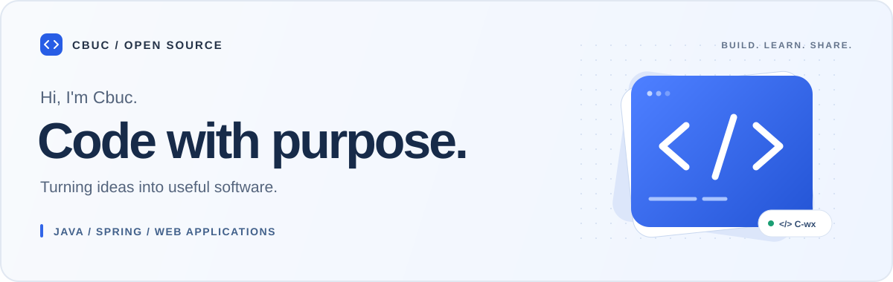

  

  <a href="#selected-work">Selected work</a> &nbsp; / &nbsp;
  <a href="#toolbox">Toolbox</a> &nbsp; / &nbsp;
  <a href="#open-source-journey">Open source</a> &nbsp; / &nbsp;
  <a href="https://github.com/C-wx/C-wx/issues/new">Say hello ↗</a>

 

### A little about me

I'm **Cbuc**, a developer working with **Java, Spring and web applications**.
I enjoy turning ideas into useful software, and I'm taking the next step into open source.

写实用的代码，做有用的东西。在实践中学习，在开源中分享与成长。

 

## Selected work

A selection of projects I've built and learned from. / 从应用开发到工具实践。

<table>
<tr>
<td width="50%" valign="top">
01 &nbsp; / &nbsp; WEB APPLICATION
<h3><a href="https://github.com/C-wx/Cbuc-Blog">Cbuc Blog ↗</a></h3>

A personal blog built with Spring Boot. 基于 Spring Boot 的个人博客，记录技术探索。

<code>Java</code> <code>Spring Boot</code>

</td>
<td width="50%" valign="top">
02 &nbsp; / &nbsp; DEVELOPER TOOL
<h3><a href="https://github.com/C-wx/cbuc_generator">Code Generator ↗</a></h3>

A code generation project. 代码生成器，让重复工作交给工具。

<code>JavaScript</code> <code>Tooling</code>

</td>
</tr>
<tr>
<td width="50%" valign="top">
03 &nbsp; / &nbsp; COMMERCE
<h3><a href="https://github.com/C-wx/Cbuc-BookMall">Book Mall ↗</a></h3>

A Java e-commerce application. 仿淘宝商城，探索电商业务与应用开发。

<code>Java</code> <code>E-commerce</code>

</td>
<td width="50%" valign="top">
04 &nbsp; / &nbsp; FRONTEND
<h3><a href="https://github.com/C-wx/blog-front">Blog Frontend ↗</a></h3>

A Vue frontend for a personal blog. 个人博客前台，用 Vue 构建内容展示界面。

<code>Vue</code> <code>JavaScript</code>

</td>
</tr>
</table>

<a href="https://github.com/C-wx?tab=repositories">Explore all repositories →</a>

 

## Toolbox

**Backend** &nbsp; Java · Spring Boot · Spring Cloud  
**Frontend** &nbsp; JavaScript · Vue · HTML · CSS  
**Workflow** &nbsp; Git · GitHub

 

## Open source journey

I'm building my contribution journey around the tools I use and the problems I understand.

- **Start small.** Reproduce issues, improve documentation and work toward focused fixes.
- **Share the process.** Turn practical experience into useful examples and reusable tools.
- **Build together.** Learn from maintainers, welcome feedback and improve one step at a time.

从一个可复现的问题、一处更清晰的文档、一次小而扎实的改进开始。

[My pull requests ↗](https://github.com/pulls?q=is%3Apr+author%3AC-wx) &nbsp; · &nbsp; [Ideas & conversations ↗](https://github.com/C-wx/C-wx/issues)

 

---

  <strong>Useful code. Clear intent. Continuous improvement.</strong> 
  Thanks for stopping by. Let's build something useful.

